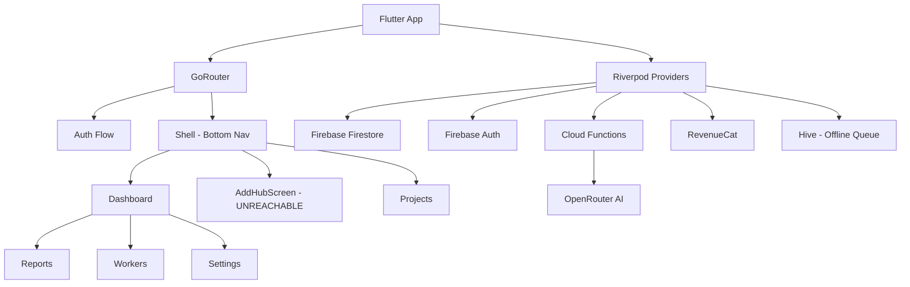

# Buildozer — Full Project Review & Improvement Recommendations

# Buildozer — Full Project Review & Improvement Recommendations

**App**: Buildozer (package: `buildtrack_app`) — Mobile-first construction operations & accounting app
**Stack**: Flutter + Riverpod + GoRouter | Firebase Auth + Firestore + Storage + Cloud Functions | RevenueCat | OpenRouter AI
**Review Date**: June 2026

## Executive Summary

Buildozer is a well-structured, production-grade construction management app with strong foundations: clean feature-first architecture, offline queue, role-based access, voice AI expense entry, PDF reporting, and subscription gating. The codebase is disciplined and consistent. The recommendations below are organized by impact area and focus on closing gaps that would meaningfully improve user experience, reliability, and business outcomes.

## 1. Navigation & Information Architecture

### Current State

- Bottom nav has only **2 tabs** (Home, Projects) plus a floating speed-dial `+` button
- The speed-dial opens 4 actions in an arc (Add Worker Entry, Add Expense, Add Payment, Voice Expense)
- Reports, Workers, Settings, Notifications are all reachable only via deep links from other screens or the Dashboard quick-action cards
- The `AddHubScreen` (tab 2 in the shell) is **never reachable** from the bottom nav — the shell branch index 1 maps to `AddHubScreen` but the nav bar only shows Home and Projects

### Issues Found

1. **Dead branch**: `StatefulShellBranch` at index 1 (`AddHubScreen`) is defined in the router but the `NavigationBar` only has 2 destinations mapped to branches 0 and 2. Branch 1 is unreachable via the nav bar.
2. **Reports is buried**: Users must go Dashboard → Reports or Project Detail → Reports. There is no persistent nav entry.
3. **Workers, Contractors, Equipment, Transport** are only reachable from the Add Hub or project detail — no top-level entry point.
4. **Notifications** has a screen but no nav entry or badge indicator anywhere in the shell.

### Recommendations

#### R1.1 — Fix the Dead Navigation Branch

The `AddHubScreen` branch should either be wired to a visible nav destination or removed. The current mapping `navIdx == 1 ? 2 : 0` skips branch 1 entirely.

#### R1.2 — Expand Bottom Nav to 4 Tabs

Add **Reports** and **Add** (hub) as persistent bottom nav destinations:

```wireframe

<html>
<head>
<style>
body { font-family: sans-serif; margin: 0; background: #f8fafc; }
.nav { display: flex; background: white; border-top: 1px solid #e2e8f0; padding: 8px 0 16px; position: fixed; bottom: 0; width: 100%; box-shadow: 0 -2px 12px rgba(0,0,0,0.08); }
.nav-item { flex: 1; display: flex; flex-direction: column; align-items: center; gap: 4px; cursor: pointer; padding: 4px 0; }
.nav-icon { width: 24px; height: 24px; background: #e2e8f0; border-radius: 6px; }
.nav-icon.active { background: #FF6D00; }
.nav-label { font-size: 11px; color: #64748b; }
.nav-label.active { color: #FF6D00; font-weight: 700; }
.fab { width: 48px; height: 48px; background: #FF6D00; border-radius: 50%; display: flex; align-items: center; justify-content: center; color: white; font-size: 24px; margin-top: -16px; box-shadow: 0 4px 12px rgba(255,109,0,0.4); }
.badge { width: 8px; height: 8px; background: #EF4444; border-radius: 50%; position: absolute; top: 2px; right: 18px; }
.nav-item { position: relative; }
.screen { padding: 16px; padding-bottom: 80px; }
h3 { color: #0f172a; margin: 0 0 8px; }
.card { background: white; border-radius: 16px; padding: 16px; margin-bottom: 12px; border: 1px solid #e2e8f0; }
</style>
</head>
<body>
<div class="screen">
  <h3>Proposed 4-Tab Navigation</h3>
  <div class="card">Home — Dashboard overview, metrics, quick actions</div>
  <div class="card">+ Add — Hub for all creation actions (expenses, payments, workers, voice)</div>
  <div class="card">Reports — Analytics, charts, PDF export</div>
  <div class="card">Projects — Project list, detail, archive</div>
</div>
<div class="nav">
  <div class="nav-item">
    <div class="nav-icon active"></div>
    <span class="nav-label active">Home</span>
  </div>
  <div class="nav-item">
    <div class="fab">+</div>
    <span class="nav-label">Add</span>
  </div>
  <div class="nav-item">
    <div class="nav-icon"></div>
    <span class="nav-label">Reports</span>
    <div class="badge"></div>
  </div>
  <div class="nav-item">
    <div class="nav-icon"></div>
    <span class="nav-label">Projects</span>
  </div>
</div>
</body>
</html>
```

#### R1.3 — Add Notification Badge to Shell

The `NotificationsScreen` exists but there is no badge or entry point in the shell. Add a bell icon with an unread count badge to the Dashboard `AppBar` and wire it to the notifications screen.

## 2. Dashboard UX

### Current State

The dashboard shows: offline sync status → Overview metrics (4 cards) → Weekly Summary (3 cards) → Weekly Insights (4 cards + payment breakdown + recent transactions) → Quick Actions → Usage Card → Upgrade Banner.

### Issues Found

1. **Too much vertical scroll before reaching Quick Actions** — the most-used feature is buried below 3 metric sections.
2. **Loading states are silent** (`SizedBox.shrink()`) — users see blank space with no skeleton or shimmer while data loads.
3. **Error states are raw** — errors show raw exception strings to users (e.g., `e.toString()` in the summary error card).
4. **No pull-to-refresh** — the dashboard `ListView` has no `RefreshIndicator`.
5. **Weekly Insights "Top Entity" / "Top Category"** show `unassigned` as a value with no explanation.
6. **Upgrade banner** is shown at the very bottom — low visibility for a key monetization touchpoint.

### Recommendations

#### R2.1 — Reorder Dashboard Sections

Move Quick Actions to the top (below offline status), then metrics. Users open the app to act, not to read numbers.

```wireframe

<html>
<head>
<style>
body { font-family: sans-serif; margin: 0; background: #f8fafc; padding: 16px; }
h3 { color: #0f172a; margin: 0 0 12px; font-size: 16px; }
.section { margin-bottom: 20px; }
.label { font-size: 11px; color: #64748b; font-weight: 700; letter-spacing: 0.5px; text-transform: uppercase; margin-bottom: 8px; }
.grid { display: grid; grid-template-columns: 1fr 1fr; gap: 10px; }
.card { background: white; border-radius: 14px; padding: 14px; border: 1px solid #e2e8f0; }
.action { display: flex; flex-direction: column; align-items: center; gap: 8px; }
.icon { width: 44px; height: 44px; border-radius: 12px; }
.icon.red { background: #FEE2E2; }
.icon.green { background: #D1FAE5; }
.icon.orange { background: #FFF0E6; }
.icon.blue { background: #DBEAFE; }
.metric { display: flex; flex-direction: column; gap: 4px; }
.metric-val { font-size: 18px; font-weight: 700; color: #0f172a; }
.metric-lbl { font-size: 12px; color: #64748b; }
.banner { background: linear-gradient(135deg, #FF6D00, #FF9100); border-radius: 16px; padding: 14px 16px; color: white; display: flex; align-items: center; gap: 12px; margin-bottom: 20px; }
.banner-text { flex: 1; }
.banner-title { font-weight: 700; font-size: 15px; }
.banner-sub { font-size: 12px; opacity: 0.9; }
</style>
</head>
<body>
<h3>Proposed Dashboard Order</h3>

<div class="section">
  <div class="label">Quick Actions</div>
  <div class="grid">
    <div class="card action"><div class="icon red"></div><span style="font-size:13px;font-weight:600">Add Expense</span></div>
    <div class="card action"><div class="icon green"></div><span style="font-size:13px;font-weight:600">Add Payment</span></div>
    <div class="card action"><div class="icon orange"></div><span style="font-size:13px;font-weight:600">Workers</span></div>
    <div class="card action"><div class="icon blue"></div><span style="font-size:13px;font-weight:600">New Project</span></div>
  </div>
</div>

<div class="section">
  <div class="label">This Month</div>
  <div class="grid">
    <div class="card metric"><div class="metric-val" style="color:#EF4444">EGP 42,000</div><div class="metric-lbl">Total Expenses</div></div>
    <div class="card metric"><div class="metric-val" style="color:#10B981">EGP 65,000</div><div class="metric-lbl">Total Income</div></div>
    <div class="card metric"><div class="metric-val" style="color:#10B981">EGP 23,000</div><div class="metric-lbl">Net Profit</div></div>
    <div class="card metric"><div class="metric-val" style="color:#FF6D00">5</div><div class="metric-lbl">Active Projects</div></div>
  </div>
</div>

<div class="banner">
  <div style="width:36px;height:36px;background:rgba(255,255,255,0.2);border-radius:50%;display:flex;align-items:center;justify-content:center">⭐</div>
  <div class="banner-text"><div class="banner-title">Upgrade to Pro</div><div class="banner-sub">Unlock unlimited projects & reports</div></div>
  <span>›</span>
</div>
</body>
</html>
```

#### R2.2 — Add Skeleton Loading States

Replace `SizedBox.shrink()` loading states with shimmer/skeleton placeholders so users understand data is loading.

#### R2.3 — Sanitize Error Messages

Wrap raw errors in user-friendly messages. Never show `e.toString()` directly. Use a helper like `AppErrorMessages.fromException(e)`.

#### R2.4 — Add Pull-to-Refresh

Wrap the dashboard `ListView` in a `RefreshIndicator` that re-fetches all summary providers.

## 3. Voice Expense Flow

### Current State

The voice flow is: Record (20s max) → Upload to Storage → Cloud Function (transcribe → rule parse → LLM fallback) → Review → Confirm → Save.

### Issues Found

1. **20-second hard cap** is too short for complex multi-item expense descriptions, especially in Arabic.
2. **The ****`_WaveformVisualizer`**** widget is commented out** in `voice_record_screen.dart` — the recording screen shows only a mic button with no audio feedback.
3. **Recording timer is not displayed** — users don't know how many seconds remain.
4. **Currency is hardcoded** to `'EGP'` in `_goToProcessing()` — it ignores the user's `defaultCurrency` setting.
5. **Play-back is debug-only** (`kDebugMode` guard) — users cannot review their recording before processing.
6. **No waveform or amplitude visualization** during recording — the `_WaveformVisualizer` class exists but is unused.
7. **Error messages** use raw strings like `"Play error: $e"`.

### Recommendations

#### R3.1 — Extend Recording Limit & Show Countdown

Increase the cap to 60 seconds. Show a visible countdown timer and progress ring around the mic button.

#### R3.2 — Enable Waveform Visualization

Uncomment and wire the `_WaveformVisualizer` widget. It already exists and is fully implemented — it just needs to be placed in the widget tree.

#### R3.3 — Enable Playback for All Users

Remove the `kDebugMode` guard from the playback button. Users should always be able to review their recording before submitting.

#### R3.4 — Use User's Currency Setting

Replace the hardcoded `'EGP'` with `ref.read(currentUserSettingsProvider).valueOrNull?.defaultCurrency ?? 'EGP'`.

```wireframe

<html>
<head>
<style>
body { font-family: sans-serif; margin: 0; background: #f8fafc; display: flex; flex-direction: column; align-items: center; min-height: 100vh; }
.appbar { width: 100%; background: transparent; padding: 16px 20px; display: flex; align-items: center; gap: 12px; box-sizing: border-box; }
.title { font-weight: 700; font-size: 18px; color: #0f172a; }
.body { flex: 1; display: flex; flex-direction: column; align-items: center; justify-content: center; gap: 24px; width: 100%; padding: 20px; box-sizing: border-box; }
.timer-ring { width: 160px; height: 160px; border-radius: 50%; border: 4px solid #e2e8f0; display: flex; align-items: center; justify-content: center; position: relative; }
.timer-ring.recording { border-color: #EF4444; }
.mic-btn { width: 100px; height: 100px; border-radius: 50%; background: #FF6D00; display: flex; align-items: center; justify-content: center; color: white; font-size: 40px; box-shadow: 0 8px 24px rgba(255,109,0,0.4); }
.mic-btn.recording { background: #EF4444; box-shadow: 0 8px 24px rgba(239,68,68,0.4); }
.countdown { position: absolute; top: 8px; right: 8px; background: #EF4444; color: white; border-radius: 12px; padding: 2px 8px; font-size: 12px; font-weight: 700; }
.waveform { display: flex; align-items: center; gap: 3px; height: 40px; }
.bar { width: 4px; border-radius: 2px; background: #FF6D00; }
.status { font-size: 14px; color: #64748b; font-weight: 500; }
.bottom { width: 100%; background: white; border-radius: 32px 32px 0 0; padding: 24px 24px 40px; box-shadow: 0 -4px 20px rgba(0,0,0,0.05); display: flex; gap: 12px; box-sizing: border-box; }
.btn { flex: 1; padding: 16px; border-radius: 16px; font-weight: 700; font-size: 15px; text-align: center; }
.btn-outline { border: 1px solid #e2e8f0; color: #0f172a; background: white; }
.btn-filled { background: #FF6D00; color: white; }
.playback { display: flex; align-items: center; gap: 8px; background: rgba(255,109,0,0.1); border-radius: 20px; padding: 8px 16px; }
</style>
</head>
<body>
<div class="appbar">
  <div style="width:32px;height:32px;background:#e2e8f0;border-radius:8px"></div>
  <div class="title">Voice Expense</div>
</div>
<div class="body">
  <div class="status">Recording... speak your expense</div>
  <div class="timer-ring recording">
    <div class="mic-btn recording">⏹</div>
    <div class="countdown">42s left</div>
  </div>
  <div class="waveform">
    <div class="bar" style="height:12px"></div><div class="bar" style="height:28px"></div><div class="bar" style="height:20px"></div>
    <div class="bar" style="height:36px"></div><div class="bar" style="height:16px"></div><div class="bar" style="height:32px"></div>
    <div class="bar" style="height:24px"></div><div class="bar" style="height:40px"></div><div class="bar" style="height:18px"></div>
    <div class="bar" style="height:30px"></div><div class="bar" style="height:22px"></div><div class="bar" style="height:38px"></div>
  </div>
  <div class="playback">▶ Play back recording</div>
</div>
<div class="bottom">
  <div class="btn btn-outline">Cancel</div>
  <div class="btn btn-filled">Process Voice</div>
</div>
</body>
</html>
```

## 4. Expenses & Payments Screens

### Current State

Both screens have full-featured filter sheets, pagination, grouping, PDF export, and search. The code is well-structured.

### Issues Found

1. **Filter sheet is very long** — category, payment method, entity, date range, and group-by are all in one modal. On small screens this requires heavy scrolling.
2. **Active filter chips** are shown but tapping them doesn't remove individual filters — only "Clear All" works.
3. **Empty state** shows a generic icon with no call-to-action button to add the first expense/payment.
4. **Expense grouping** (by date, category, entity) is a great feature but the group-by button is not visually distinct from the filter button.
5. **PDF export** is available but there is no share/save option — it only opens the print dialog.
6. **No bulk actions** — users cannot select multiple expenses to archive or delete at once.

### Recommendations

#### R4.1 — Tappable Filter Chips for Individual Removal

Each active filter chip should have an `×` icon that removes only that filter, not all filters.

#### R4.2 — Empty State with CTA

When no expenses exist, show an illustration + "Add your first expense" button that navigates to `AddExpenseScreen`.

#### R4.3 — Add Share/Save to PDF Export

Use the `printing` package's `Printing.sharePdf()` method alongside `layoutPdf` to give users a share sheet option.

#### R4.4 — Visual Distinction for Group-By vs Filter

Use different icon styles or a segmented control to make grouping and filtering visually distinct.

## 5. Projects Screen

### Current State

Projects list with search, pagination, archive/delete via popup menu, and profit/loss display per project.

### Issues Found

1. **Project status filter is missing** — users cannot filter by `active` vs `completed` vs `on_hold`.
2. **Sort order is not user-controllable** — projects are always sorted by creation date descending.
3. **Project card shows only net profit** — no quick view of total expenses vs income without tapping into the project.
4. **Archive confirmation is missing** — archiving is immediate with no undo or confirmation dialog (unlike delete which has a dialog).
5. **The ****`allProjectsProvider`** is defined but appears unused in the projects screen — it fetches all projects including archived, which could be useful for the reports project selector.

### Recommendations

#### R5.1 — Add Status Filter Tabs

Add a `TabBar` or `SegmentedButton` at the top of the projects screen: All | Active | Completed | On Hold.

#### R5.2 — Add Archive Confirmation

Show a confirmation dialog before archiving, consistent with the delete flow.

#### R5.3 — Expand Project Card Metrics

Show a mini progress bar or two-line metric (Expenses / Income) on the project card alongside net profit.

```wireframe

<html>
<head>
<style>
body { font-family: sans-serif; margin: 0; background: #f8fafc; padding: 16px; }
.tabs { display: flex; gap: 8px; margin-bottom: 16px; overflow-x: auto; }
.tab { padding: 8px 16px; border-radius: 20px; font-size: 13px; font-weight: 600; white-space: nowrap; cursor: pointer; }
.tab.active { background: #FF6D00; color: white; }
.tab.inactive { background: white; color: #64748b; border: 1px solid #e2e8f0; }
.card { background: white; border-radius: 20px; padding: 16px; margin-bottom: 12px; border: 1px solid #e2e8f0; }
.row { display: flex; align-items: center; gap: 12px; }
.icon-box { width: 44px; height: 44px; background: rgba(255,109,0,0.1); border-radius: 12px; flex-shrink: 0; }
.info { flex: 1; }
.name { font-weight: 700; color: #0f172a; font-size: 15px; }
.client { font-size: 12px; color: #64748b; margin-top: 2px; }
.badge { font-size: 10px; font-weight: 700; padding: 2px 8px; border-radius: 4px; background: #D1FAE5; color: #10B981; }
.metrics { display: flex; gap: 16px; margin-top: 10px; padding-top: 10px; border-top: 1px solid #f1f5f9; }
.metric { flex: 1; }
.metric-val { font-size: 13px; font-weight: 700; }
.metric-lbl { font-size: 11px; color: #64748b; }
.progress { height: 4px; background: #f1f5f9; border-radius: 2px; margin-top: 8px; }
.progress-fill { height: 4px; background: #10B981; border-radius: 2px; width: 65%; }
</style>
</head>
<body>
<div class="tabs">
  <div class="tab active">All</div>
  <div class="tab inactive">Active</div>
  <div class="tab inactive">Completed</div>
  <div class="tab inactive">On Hold</div>
</div>
<div class="card">
  <div class="row">
    <div class="icon-box"></div>
    <div class="info">
      <div class="name">Villa October <span class="badge">ACTIVE</span></div>
      <div class="client">👤 Ahmed Hassan</div>
    </div>
    <div style="text-align:right">
      <div style="font-weight:700;color:#10B981;font-size:16px">+EGP 23,000</div>
      <div style="font-size:12px;color:#64748b">Profit</div>
    </div>
  </div>
  <div class="metrics">
    <div class="metric"><div class="metric-val" style="color:#EF4444">EGP 42,000</div><div class="metric-lbl">Expenses</div></div>
    <div class="metric"><div class="metric-val" style="color:#10B981">EGP 65,000</div><div class="metric-lbl">Income</div></div>
  </div>
  <div class="progress"><div class="progress-fill"></div></div>
</div>
</body>
</html>
```

## 6. Reports Screen

### Current State

Reports has role-gated access, project selector, 5 chart types, recent tables, PDF export (project, weekly, combined, custom), and entity summary navigation.

### Issues Found

1. **Export buttons are a horizontal scroll row** — on small screens users may not discover all export options.
2. **Custom report builder** uses a bottom sheet with checkboxes — the date range picker shows "Date Range" as placeholder text which is not descriptive.
3. **No date range filter on the main reports view** — charts always show all-time data for the selected project.
4. **The ****`_SectionHeader`**** in reports** is a private local class, duplicating the `SectionHeader` widget in `lib/core/widgets/section_header.dart`.
5. **Charts have no empty state** — when a project has no data, charts render with empty axes and no message.
6. **No share/export for individual charts** — users can only export the full PDF, not a single chart image.

### Recommendations

#### R6.1 — Consolidate Export Actions into a Menu

Replace the horizontal scroll row of export buttons with a single "Export" button that opens a bottom sheet or popup menu with all export options.

#### R6.2 — Add Date Range Filter to Main Reports View

Add a date range picker at the top of the reports content (below the project selector) that scopes all charts and tables.

#### R6.3 — Deduplicate `_SectionHeader`

Remove the local `_SectionHeader` in `reports_screen.dart` and use the shared file:lib/core/widgets/section_header.dart widget.

#### R6.4 — Add Chart Empty States

When chart data is empty, show a centered illustration with a message like "No expenses recorded for this period."

## 7. Subscription & Plans Screen

### Current State

Plans screen loads RevenueCat packages, shows a paywall button and individual package cards. Falls back to hardcoded prices if RevenueCat returns empty.

### Issues Found

1. **Hardcoded fallback prices** (`$9.99`, `$89.99`, `$249.99`) are USD-only and will show incorrect prices for non-US users.
2. **The plans screen design is minimal** — plain `Card` + `ListTile` layout with no feature comparison or value proposition.
3. **No "Most Popular" or "Best Value" badge** on the recommended plan.
4. **Trial information** is shown as a generic card — it doesn't show the actual trial duration from RevenueCat.
5. **`LimitReachedScreen`** exists but its design is not reviewed here — it should clearly explain what the limit is and offer a direct upgrade path.

### Recommendations

#### R7.1 — Remove Hardcoded Fallback Prices

If RevenueCat returns no packages, show an error state with a retry button rather than fake prices.

#### R7.2 — Redesign Plans Screen with Feature Comparison

```wireframe

<html>
<head>
<style>
body { font-family: sans-serif; margin: 0; background: #f8fafc; padding: 20px; }
h2 { color: #0f172a; margin: 0 0 4px; font-size: 22px; }
.sub { color: #64748b; font-size: 14px; margin-bottom: 24px; }
.plan { background: white; border-radius: 20px; padding: 20px; margin-bottom: 16px; border: 2px solid #e2e8f0; }
.plan.featured { border-color: #FF6D00; }
.plan-header { display: flex; justify-content: space-between; align-items: flex-start; margin-bottom: 16px; }
.plan-name { font-weight: 700; font-size: 18px; color: #0f172a; }
.plan-price { font-weight: 800; font-size: 22px; color: #FF6D00; }
.plan-period { font-size: 12px; color: #64748b; }
.badge { background: #FF6D00; color: white; font-size: 11px; font-weight: 700; padding: 3px 10px; border-radius: 20px; }
.features { list-style: none; padding: 0; margin: 0 0 16px; }
.features li { padding: 6px 0; font-size: 14px; color: #0f172a; display: flex; gap: 8px; }
.features li::before { content: "✓"; color: #10B981; font-weight: 700; }
.btn { width: 100%; padding: 14px; border-radius: 14px; font-weight: 700; font-size: 15px; text-align: center; box-sizing: border-box; }
.btn-primary { background: #FF6D00; color: white; }
.btn-outline { border: 2px solid #e2e8f0; color: #0f172a; background: white; }
.savings { font-size: 12px; color: #10B981; font-weight: 600; margin-top: 4px; }
</style>
</head>
<body>
<h2>Choose Your Plan</h2>
<div class="sub">Unlock the full power of Buildozer</div>

<div class="plan featured">
  <div class="plan-header">
    <div>
      <div class="plan-name">Pro Yearly</div>
      <div class="savings">Save 25% vs monthly</div>
    </div>
    <div style="text-align:right">
      <div class="badge">BEST VALUE</div>
      <div class="plan-price">$89.99</div>
      <div class="plan-period">per year</div>
    </div>
  </div>
  <ul class="features">
    <li>Unlimited projects</li>
    <li>Unlimited expenses & payments</li>
    <li>Voice expense entry (AI)</li>
    <li>PDF reports & export</li>
    <li>Team management</li>
    <li>Priority support</li>
  </ul>
  <div class="btn btn-primary">Start 7-Day Free Trial</div>
</div>

<div class="plan">
  <div class="plan-header">
    <div><div class="plan-name">Pro Monthly</div></div>
    <div style="text-align:right">
      <div class="plan-price">$9.99</div>
      <div class="plan-period">per month</div>
    </div>
  </div>
  <div class="btn btn-outline">Choose Monthly</div>
</div>
</body>
</html>
```

## 8. Settings Screen

### Current State

Settings has: profile section, language toggle (AR/EN), currency dropdown (EGP/USD/SAR/AED), notifications toggle, edit profile, team management, subscription section, debug Crashlytics section, and logout.

### Issues Found

1. **Currency options are limited** — only 4 currencies. Construction projects in the MENA region also use KWD, QAR, BHD, OMR, JOD.
2. **Error handling for currency/notification updates is silenced** — the `catchError` callbacks have commented-out `showSnackBar` calls, so failures are invisible to users.
3. **No app version display** — users and support teams cannot identify the installed version.
4. **No "About" or "Help" section** — no link to documentation, privacy policy, or terms of service.
5. **Debug Crashlytics section** is shown in `kDebugMode` — this is fine, but the "Force crash" button should require a confirmation dialog.

### Recommendations

#### R8.1 — Restore Error Feedback for Settings Updates

Uncomment the `showSnackBar` calls in currency and notification update error handlers.

#### R8.2 — Add App Version & About Section

Show app version (from `package_info_plus`) and add links to Privacy Policy and Terms of Service.

#### R8.3 — Expand Currency List

Add KWD, QAR, BHD, OMR, JOD to the currency dropdown.

## 9. Authentication Flow

### Current State

Login screen has email/password + Google Sign-In. Signup, forgot password, onboarding, and features screens exist.

### Issues Found

1. **Google logo is loaded from Wikipedia via ****`Image.network`** — this is a network dependency that fails offline and is a ToS risk. The Google logo should be a local asset.
2. **Password field has no show/hide toggle** — `obscureText: true` with no visibility toggle is a UX friction point.
3. **No "Remember me" or biometric login** — users must re-enter credentials after logout.
4. **Login screen uses ****`Icons.construction_rounded`** as a logo placeholder — the actual app icon (`assets/branding/app_icon.png`) should be used.
5. **Form validation** happens only on submit, not inline — email format is not validated as the user types.

### Recommendations

#### R9.1 — Use Local Google Logo Asset

Add the Google `G` logo as a local SVG/PNG asset instead of fetching from Wikipedia.

#### R9.2 — Add Password Visibility Toggle

Add an `IconButton` suffix to the password field to toggle `obscureText`.

#### R9.3 — Use App Icon on Login Screen

Replace `Icons.construction_rounded` with `Image.asset('assets/branding/app_icon.png')`.

```wireframe

<html>
<head>
<style>
body { font-family: sans-serif; margin: 0; background: #f8fafc; display: flex; flex-direction: column; align-items: center; padding: 32px 24px; }
.logo { width: 72px; height: 72px; background: #FF6D00; border-radius: 20px; margin-bottom: 20px; display: flex; align-items: center; justify-content: center; color: white; font-size: 36px; }
h1 { font-size: 28px; font-weight: 900; color: #0f172a; margin: 0 0 8px; letter-spacing: -1px; }
.sub { color: #64748b; font-size: 15px; margin-bottom: 32px; }
.card { background: white; border-radius: 24px; padding: 24px; width: 100%; max-width: 360px; box-sizing: border-box; box-shadow: 0 4px 20px rgba(0,0,0,0.06); border: 1px solid rgba(226,232,240,0.5); }
.field { border: 1px solid #e2e8f0; border-radius: 12px; padding: 14px 16px; margin-bottom: 14px; display: flex; align-items: center; gap: 10px; background: white; }
.field-icon { width: 20px; height: 20px; background: #e2e8f0; border-radius: 4px; flex-shrink: 0; }
.field-text { flex: 1; color: #64748b; font-size: 14px; }
.eye { width: 20px; height: 20px; background: #e2e8f0; border-radius: 4px; flex-shrink: 0; }
.forgot { text-align: right; color: #64748b; font-size: 13px; font-weight: 600; margin-bottom: 16px; }
.btn-primary { background: #FF6D00; color: white; border-radius: 12px; padding: 16px; text-align: center; font-weight: 700; font-size: 16px; margin-bottom: 12px; }
.btn-google { border: 1px solid #e2e8f0; border-radius: 12px; padding: 14px; text-align: center; font-weight: 600; font-size: 15px; display: flex; align-items: center; justify-content: center; gap: 10px; background: white; }
.g-logo { width: 20px; height: 20px; background: #4285F4; border-radius: 50%; }
.signup { text-align: center; color: #64748b; font-size: 14px; margin-top: 20px; }
.signup span { color: #FF6D00; font-weight: 700; }
</style>
</head>
<body>
<div class="logo">🏗</div>
<h1>Welcome Back</h1>
<div class="sub">Sign in to continue</div>
<div class="card">
  <div class="field"><div class="field-icon"></div><div class="field-text">Email address</div></div>
  <div class="field"><div class="field-icon"></div><div class="field-text">Password</div><div class="eye"></div></div>
  <div class="forgot">Forgot password?</div>
  <div class="btn-primary">Sign In</div>
  <div class="btn-google"><div class="g-logo"></div>Continue with Google</div>
</div>
<div class="signup">Don't have an account? <span>Sign up</span></div>
</body>
</html>
```

## 10. Offline Queue & Sync

### Current State

Offline queue uses Hive (`offline_actions` box), with coordinator, drain logic, dead-letter tracking, and UI indicators in the dashboard and bottom nav shell.

### Issues Found

1. **Dead-letter items have no detail view** — users see "X items failed to sync" but cannot see which items failed or why.
2. **No retry for individual failed items** — only a global "Retry" button exists.
3. **Offline banner** in the shell is a top bar that pushes content down — this can cause layout jumps when connectivity changes.
4. **No conflict resolution UI** — the plan uses "last-saved-change-wins" but users are never informed when a conflict was resolved.

### Recommendations

#### R10.1 — Add Sync Status Detail Screen

Create a "Sync Status" screen accessible from the dashboard sync card that lists pending and failed items with their type, timestamp, and error reason.

#### R10.2 — Animate Offline Banner

Use an `AnimatedContainer` or `AnimatedSwitcher` for the offline banner to avoid layout jumps.

## 11. Workers, Contractors, Equipment, Transport

### Current State

All four entity types have accounting screens with paginated records. Workers additionally have a detail screen and add/edit flow.

### Issues Found

1. **Contractors, Equipment, and Transport have no list/management screens** — they are only accessible as accounting sub-screens from a project context. There is no way to browse all contractors across projects.
2. **Workers screen has no search** — unlike the projects screen, the workers list has no search bar.
3. **Worker accounting screen** shows records but has no summary totals (total paid, total owed).
4. **No worker status** (active/inactive/terminated) — all workers appear in the same list.

### Recommendations

#### R11.1 — Add Cross-Project Entity Lists

Add top-level screens for Contractors, Equipment, and Transport that aggregate records across all projects, similar to the Workers screen.

#### R11.2 — Add Search to Workers Screen

Add a search bar to filter workers by name.

#### R11.3 — Add Summary Totals to Worker Accounting

Show a sticky header or summary card at the top of the worker accounting screen with total paid and balance.

## 12. Code Quality & Architecture

### Current State

The codebase follows a clean feature-first structure with Riverpod providers, repository pattern, and domain/data/presentation layers.

### Issues Found

1. **Duplicate private widgets** — `_SectionHeader`, `_ErrorCard`, `_LoadingWidget` are defined independently in `reports_screen.dart`, `settings_screen.dart`, and `dashboard_screen.dart`. The shared `SectionHeader` in `lib/core/widgets/` is not consistently used.
2. **Commented-out code** — `add_hub_screen.dart` has large blocks of commented-out `_ActionCard` widgets (expense list, payment list, create project). These should be removed or tracked as TODOs.
3. **`voice_record_screen.dart`** has a large commented-out `Column` block (lines 308–344) that should be cleaned up.
4. **Hardcoded strings** — `"Play error: $e"`, `"Pause Test"`, `"Play Test"` in `voice_record_screen.dart` are not localized.
5. **`_pickedFiles.removeAt(entry.key)`** — there is a stray file at the workspace root with this name, suggesting a copy-paste accident.
6. **`6.1.3`**** and ****`4.0.0`** — two stray files at the workspace root with version-number names, likely leftover artifacts.
7. **`googleSignInSupportedProvider`** loads asynchronously on the login screen — if it takes time, the Google button flickers in.

### Recommendations

#### R12.1 — Consolidate Shared Widgets

Move `_ErrorCard`, `_LoadingWidget`, and `_SectionHeader` variants into `lib/core/widgets/` and use them consistently across all screens.

#### R12.2 — Clean Up Commented Code & Stray Files

Remove commented-out code blocks and delete the stray files (`_pickedFiles.removeAt(entry.key)`, `6.1.3`, `4.0.0`) from the workspace root.

#### R12.3 — Localize All Strings

Audit for any hardcoded English strings not going through `AppLocalizations`.

## 13. Performance

### Current State

The app uses pagination (page size 20), maintained summary documents for dashboards, prefetching (`AppPrefetcher`), and bounded date-range queries for reports.

### Issues Found

1. **`projectsProvider`**** (StreamProvider)** watches all active projects as a real-time stream — for workspaces with many projects this is an unbounded read.
2. **Dashboard loads 3 separate Firestore providers** simultaneously (summary, weekly summary, weekly insights) — these could be combined into a single document read.
3. **Reports screen** fetches up to 500 expenses and 500 payments for custom reports in a single page — this could be slow for large datasets.
4. **`AppPrefetcher.warmAddEntry()`** is called on multiple quick-action taps but there is no deduplication if called rapidly.

### Recommendations

#### R13.1 — Cap `projectsProvider` Stream

Add a limit to the `watchProjects` query (e.g., 50 most recent active projects) and use pagination for the projects screen instead of a live stream.

#### R13.2 — Combine Dashboard Summary Reads

Merge `dashboardSummaryProvider`, `dashboardWeeklySummaryProvider`, and `dashboardWeeklyInsightsProvider` into a single Firestore document read where possible.

#### R13.3 — Add Progress Indicator for Large Report Exports

Show a loading overlay when generating custom reports with large date ranges.

## 14. Accessibility & Internationalization

### Current State

The app supports Arabic (RTL) and English with locale-aware fonts (Cairo for AR, Inter for EN). The theme switches fonts based on locale.

### Issues Found

1. **Speed-dial arc items** have no semantic labels for screen readers — `GestureDetector` wraps the items without `Semantics` widgets.
2. **Color-only status indicators** — profit/loss is shown only by color (green/red) with no icon or text pattern for color-blind users.
3. **RTL layout** — the speed-dial arc geometry uses fixed `angleDeg` values that may not mirror correctly in RTL mode.
4. **Arabic number formatting** — the `Formatters.money()` uses locale but Arabic locale may render Eastern Arabic numerals depending on the `intl` configuration.

### Recommendations

#### R14.1 — Add Semantics to Speed-Dial Items

Wrap each `_AnimatedDialItem` in a `Semantics` widget with a meaningful `label`.

#### R14.2 — Add Icon Indicators for Profit/Loss

Alongside color, show `Icons.trending_up` / `Icons.trending_down` icons so color-blind users can distinguish profit from loss.

#### R14.3 — Test RTL Speed-Dial Layout

Verify the arc geometry mirrors correctly when `TextDirection.rtl` is active.

## Priority Matrix

| Priority | Area | Recommendation |
| --- | --- | --- |
| 🔴 Critical | Navigation | Fix dead `AddHubScreen` branch (R1.1) |
| 🔴 Critical | Voice | Use user currency setting (R3.4) |
| 🔴 Critical | Settings | Restore error feedback for updates (R8.1) |
| 🔴 Critical | Auth | Replace Wikipedia Google logo with local asset (R9.1) |
| 🟠 High | Dashboard | Reorder sections — Quick Actions first (R2.1) |
| 🟠 High | Dashboard | Add pull-to-refresh (R2.4) |
| 🟠 High | Voice | Enable playback for all users (R3.3) |
| 🟠 High | Voice | Show waveform & countdown (R3.1, R3.2) |
| 🟠 High | Auth | Add password visibility toggle (R9.2) |
| 🟠 High | Plans | Remove hardcoded fallback prices (R7.1) |
| 🟡 Medium | Navigation | Expand to 4-tab nav with Reports (R1.2) |
| 🟡 Medium | Navigation | Add notification badge (R1.3) |
| 🟡 Medium | Projects | Add status filter tabs (R5.1) |
| 🟡 Medium | Reports | Consolidate export actions (R6.1) |
| 🟡 Medium | Code | Consolidate shared widgets (R12.1) |
| 🟡 Medium | Code | Clean up commented code & stray files (R12.2) |
| 🟢 Low | Dashboard | Skeleton loading states (R2.2) |
| 🟢 Low | Settings | Add app version display (R8.2) |
| 🟢 Low | Accessibility | Add Semantics to speed-dial (R14.1) |
| 🟢 Low | Accessibility | Icon indicators for profit/loss (R14.2) |

## Architecture Flow (Current)

